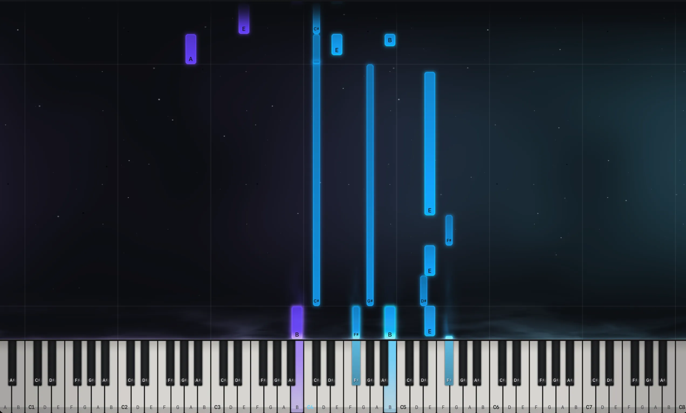

<div align="center">
  
  <h1>Aurelia</h1>
  <p>
    <strong>A fast, native desktop MIDI piano visualizer and practice studio.</strong><br />
    Built with Tauri 2, Rust, React, and Three.js (React Three Fiber).
  </p>

  <p>
    
    
    
    
  </p>

  <br />

  
</div>

<br />

## ✨ Features

### 🎹 3D Stage & Visuals
- **60fps Instanced Waterfall & 88-Key Piano:** Smooth WebGL rendering with custom shaders, selective bloom, hit-glow particles, and realistic key depression physics.
- **Note Labels & Measure Lines:** Optional pitch labels on falling notes and keys, plus instanced measure lines parsed directly from MIDI time signatures.
- **Customizable Themes:** Personalize stage colors, hand palettes, and visual effects from the in-app **Appearance & Studio** popover.

### 🔊 Native Rust Audio Engine
- **Low-Latency SoundFont Synthesis:** Powered by `cpal` and `rustysynth` with studio reverb and touch presets.
- **Bundled & Custom SoundFonts:** Ships with `SalamanderGrandPiano-V3-Lite.sf2` out of the box, with support for importing and managing custom `.sf2` SoundFonts.
- **Offline Audio Export:** Render MIDI pieces or recordings directly to **WAV** (`hound`) or **MP3** (`mp3lame-encoder`).

### 🔌 Hardware USB MIDI & Input
- **Plug-and-Play MIDI:** Automatic device detection via `midir` with direct Rust-to-Rust audio routing and sustain pedal (`CC64`) support.
- **Compact Keyboard Support:** Range dimming for `25 / 32 / 37 / 49 / 61 / 88` key controllers with automatic octave-window tracking.
- **Flexible Input:** Play using a hardware MIDI keyboard, mouse pointer, or QWERTY keyboard.

### 🎯 Study Mode & Practice Tools
- **Wait-for-Input Mode:** Pauses the waterfall at the hit line until you play the expected note(s), with chord grouping, early-hit forgiveness, and automatic skipping for out-of-range notes on compact keyboards.
- **Hand Separation & Track Controls:** Practice `Left Only`, `Right Only`, or `Both Hands` with per-track hand assignment and configurable pitch split.
- **Tempo, Transposition & Looping:** Scale playback speed (`0.25x–2.0x`), apply non-destructive per-song transposition, set **A–B loops**, and use the **Web Audio count-in** for starts and loop wraps.

### 🎙️ Free Play & Recording Studio
- **Free Play Mode:** Open the stage without a MIDI file for distraction-free playing with a built-in **Metronome**.
- **Record & Review:** Capture your live performance, review the recording, and save or export it directly to your library.

### 📚 Library & Workflow
- **Folder-Watched MIDI Library:** Persistent SQLite-backed library (`rusqlite`) with `blake3` indexing, hover audio previews, and drag-and-drop / file-dialog MIDI importing into folders.
- **Customizable Shortcuts:** Rebind playback, stage, and studio controls anytime via the Shortcut Manager (`⌘/`).

---

## 🚀 Getting Started

### Prerequisites
- **Node.js** (v18+)
- **Rust** toolchain (`rustup` / `cargo`)
- **SoundFont (`.sf2`):** Includes `src-tauri/resources/soundfonts/SalamanderGrandPiano-V3-Lite.sf2` as the bundled default piano. Additional `.sf2` files are excluded from Git and can be imported directly in-app.

### Development

```bash
npm install
npm run tauri dev
```

### Production Build & Checks

```bash
npx tsc --noEmit
npm run build
cargo test --manifest-path src-tauri/Cargo.toml
npm run tauri build
```

---

## 📄 License & Attributions

See [THIRD-PARTY-NOTICES.md](./THIRD-PARTY-NOTICES.md) for open-source library and SoundFont attributions.
